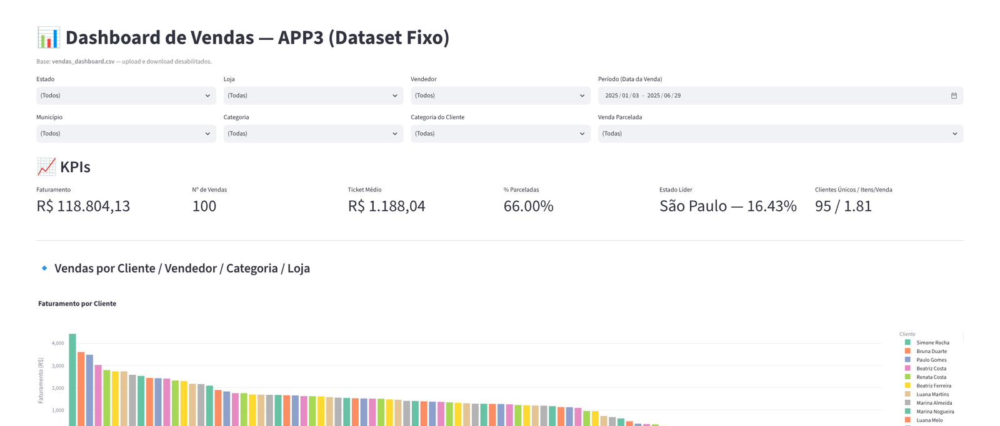
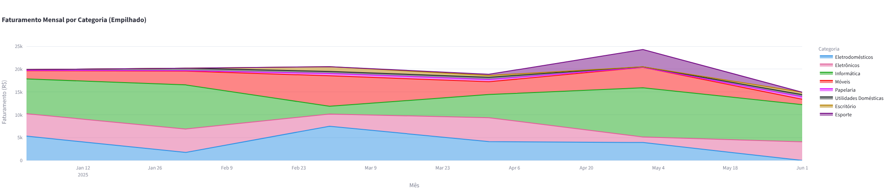
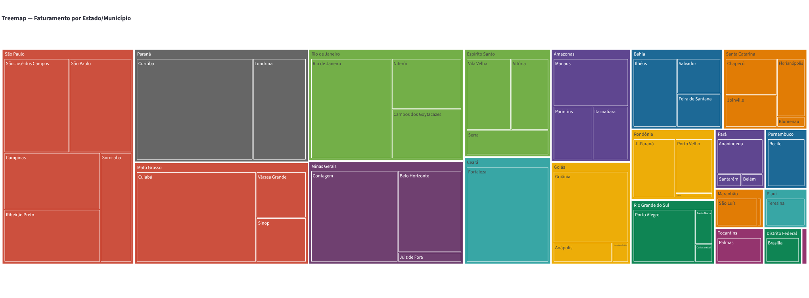

# 📊 Dashboard de Vendas (Streamlit)

Dashboard interativo de vendas feito com Python, Streamlit e Plotly. A partir de um arquivo CSV, ele mostra indicadores (KPIs), 14 gráficos e 2 mapas, e tudo pode ser filtrado por estado, município, loja, categoria, vendedor, período e tipo de cliente.



## ✨ Funcionalidades

* **8 filtros** no topo da página: estado, município, loja, categoria do produto, vendedor, categoria do cliente, período da venda e se a venda foi parcelada. O filtro de município se ajusta ao estado escolhido.
* **6 indicadores (KPIs):** faturamento, número de vendas, ticket médio, % de vendas parceladas, estado líder (com a participação no faturamento) e clientes únicos / itens por venda.
* **14 gráficos** que se atualizam com os filtros:
  * Barras: faturamento por cliente, por vendedor e por loja, quantidade por categoria, top 5 clientes e top 5 vendedores
  * Séries temporais: vendas por mês (área) e faturamento mensal por categoria (área empilhada)
  * Distribuições: histograma de ticket e boxplot do preço por categoria
  * Composição: pizzas de participação por estado e de vendas parceladas, e treemap estado → município
  * Dispersão: quantidade × preço unitário
* **2 mapas** do faturamento por cidade (Plotly e Folium).

## 🖼️ Exemplos





## 🛠️ Tecnologias

* Python 3.11 ou mais novo
* [Streamlit](https://streamlit.io) para a interface
* [pandas](https://pandas.pydata.org) para carregar e tratar os dados
* [Plotly](https://plotly.com/python/) para os gráficos e um dos mapas
* [Folium](https://python-visualization.github.io/folium/) e `streamlit-folium` para o outro mapa

## 📂 Estrutura

```text
├── appstreamlit.py        # aplicação (filtros, KPIs, gráficos e mapas)
├── vendas_dashboard.csv   # dados de exemplo: 100 vendas de jan a jun/2025
├── requirements.txt       # dependências
├── .devcontainer/         # ambiente pronto para o GitHub Codespaces
└── docs/                  # imagens usadas neste README
```

O CSV usa `;` como separador e tem uma venda por linha: vendedor, cliente, município, estado, loja, categoria do produto, quantidade, preço unitário e total, se foi parcelada, categoria do cliente e datas de venda e de entrega prevista.

## ▶️ Como rodar

```bash
git clone https://github.com/inglid-sandeski/inglid-sandeski.ied-streamlit.git
cd inglid-sandeski.ied-streamlit

pip install -r requirements.txt
streamlit run appstreamlit.py
```

O dashboard abre em `http://localhost:8501`. Os mapas usam mapas de fundo da internet, então precisam de conexão para exibir o fundo.

Também dá para abrir o repositório no **GitHub Codespaces**: o ambiente já vem configurado e o app inicia sozinho.

## 🔭 Possíveis melhorias

* Permitir trocar o arquivo de dados pela própria interface
* Exportar o recorte filtrado
* Adicionar testes para as funções de cálculo dos indicadores

## 👩‍💻 Autora

**Inglid Sandeski**: estudante de Sistemas de Informação na UNEMAT.
[GitHub](https://github.com/inglid-sandeski)
